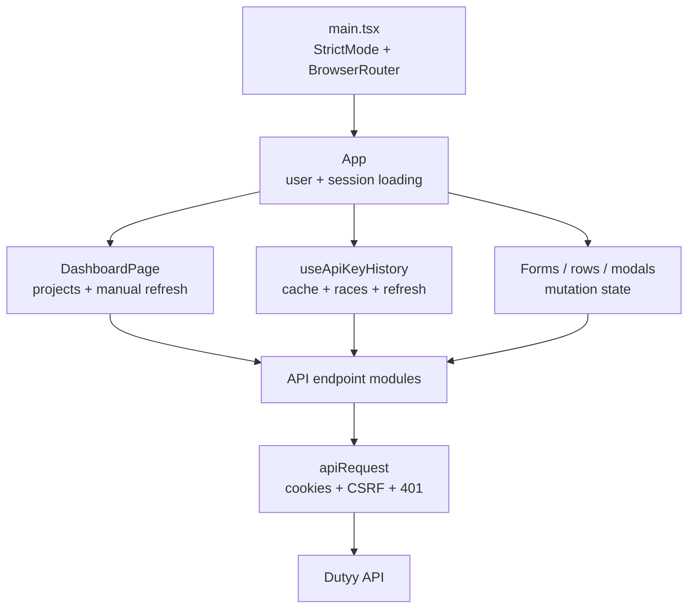
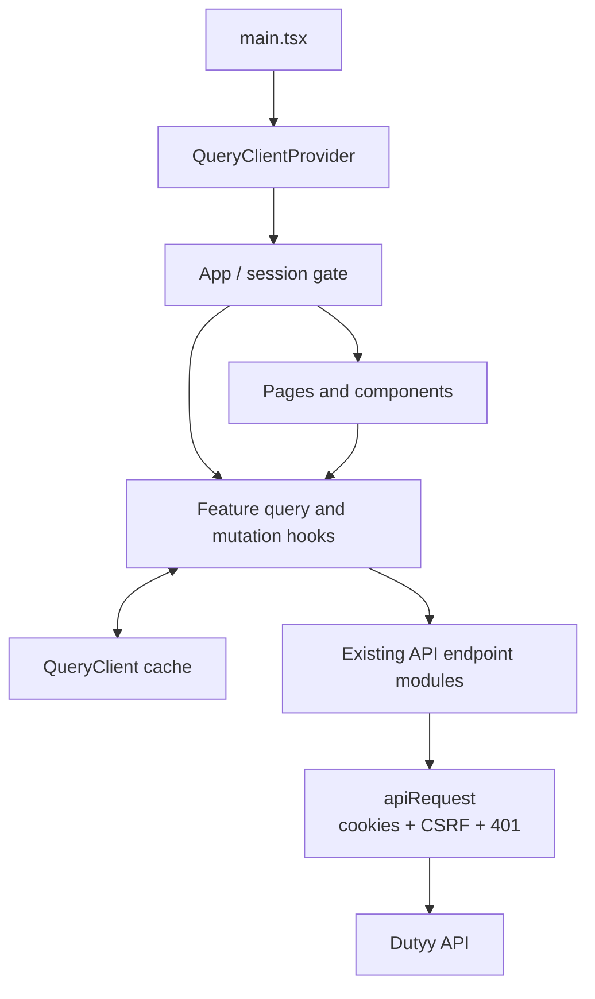
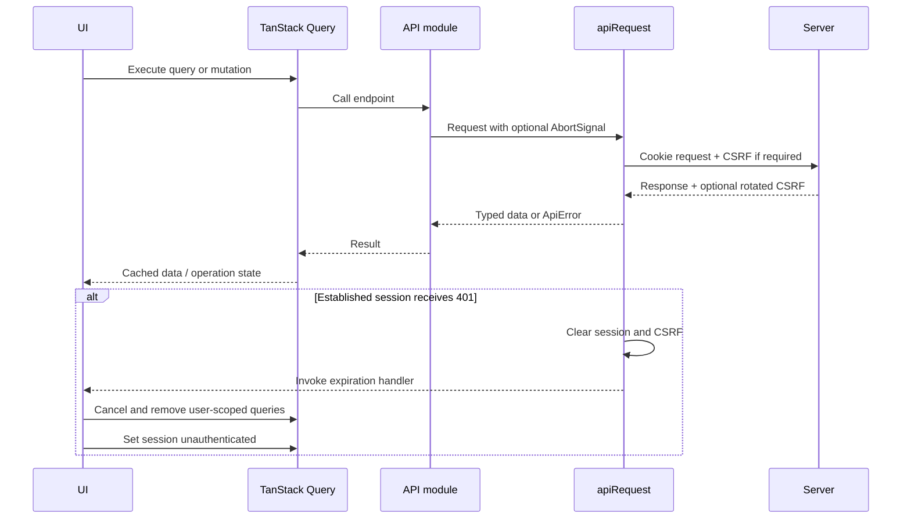

[](<>)# TanStack Query Migration Plan

## Goal

Introduce `@tanstack/react-query` incrementally and use it as the application's
server-state orchestration and cache layer.

Preserve the existing API client as the sole HTTP, authentication, cookie, CSRF,
and error boundary. Do not move client-only interaction state into the Query
cache.

This document is intended to guide manual, agent-assisted implementation. Each
phase should be implemented and validated independently.

## Recommended approach

Use TanStack Query for:

- Session restoration and cached current-user state
- Project collection state
- API-key history
- Mutation lifecycle and cache reconciliation

Keep local React state for:

- Forms and client-side validation
- Dialog, menu, and expanded-row state
- Filters and sorting controls
- Clipboard feedback
- One-time API-key secrets
- Session-expired presentation messaging

The existing architecture supports this without introducing a general-purpose
global store, service layer, or React Router loaders.

## Existing architecture

- Root composition: `StrictMode -> BrowserRouter -> App`
- `App` owns session/user state and protected-route decisions.
- `apiRequest` owns:
  - Same-origin API routing
  - Cookie credentials
  - CSRF acquisition and rotation
  - `ApiError`
  - Established-session 401 detection
- Server state is manually managed in:
  - `src/App.tsx`: session/user
  - `src/pages/DashboardPage.tsx`: projects and project reconciliation
  - `src/hooks/useApiKeyHistory.ts`: API keys, races, refreshes, and revocation
- Mutation loading and error state is distributed through forms, rows, and
  modals.
- There is no React context, global state library, or existing cache.

### Current state



## Boundaries and invariants

### API boundary

`src/api/client.ts` must remain the sole HTTP boundary. Query functions must
call the existing endpoint functions rather than calling `fetch` directly.

The following behavior must remain intact:

1. Every request uses `credentials: 'include'`.
2. Mutations receive the current in-memory CSRF token.
3. Successful responses can rotate the CSRF token.
4. An initial session-probe 401 does not trigger a "session expired" message.
5. A 401 after session establishment immediately removes protected UI.
6. A login 401 remains an invalid-credentials error.
7. Logout and session expiration remove all user-specific cached data.
8. Mutation retries remain disabled.
9. API-key secrets never enter a long-lived query cache.
10. Project and dutyy changes eventually reconcile aggregate project fields
    from the server.

### State ownership

| State                         | Owner                         |
| ----------------------------- | ----------------------------- |
| Current session/user          | Session query cache           |
| Session-expired banner/reason | Local App/auth-boundary state |
| Projects                      | Projects query cache          |
| API-key history               | API-key query cache           |
| Query loading/refetch/error   | Query                         |
| Mutation pending/error        | Mutation hooks                |
| Form values and validation    | Component-local state         |
| Dialogs, menus, expanded rows | Component-local state         |
| Filtering and sorting choices | Component-local state         |
| Issued API-key secret         | Issuing component only        |
| Clipboard status              | Component-local state         |

## Proposed architecture



Query is an orchestration and cache layer, not a replacement for the API
client.

## Query client policy

Create one stable `QueryClient` outside React render or through a one-time
initializer. It must not be recreated during Strict Mode rendering.

### Query defaults

- Retry network errors and eligible 5xx responses at most twice.
- Do not retry:
  - 401 or 403 responses
  - Validation failures
  - Conflicts
  - Other expected 4xx responses
- Use a modest default `staleTime`, approximately 30 seconds.
- Preserve the default garbage-collection policy unless tests or measured
  memory behavior indicate otherwise.
- Keep window-focus refetching enabled initially because it is useful for
  project and API-key freshness.
- Override these policies per query when required.

### Session query

- Do not retry automatically.
- Do not refetch on window focus unless the product explicitly adopts that
  behavior.
- Initially preserve the current behavior where any failed startup restore is
  treated as unauthenticated.
- Treat a distinct startup network/server-error screen as a separate product
  change.

### Mutations

- Always use `retry: false`.
- Do not introduce global user-facing mutation error handling; forms and
  features have domain-specific messages.

## Query keys

Use centralized, typed key factories rather than scattered array literals.

Conceptual keys:

- `['session']`
- `['projects', userId, 'list']`
- `['projects', userId, 'detail', projectId]`, only if detail caching becomes
  necessary
- `['apiKeys', userId, 'list']`

Including the authenticated user ID guards against accidental cache reuse
across accounts. User-scoped queries must still be explicitly removed on
logout and session expiration.

For the current dashboard, the project list should be canonical. Do not
introduce detail queries solely because a detail endpoint exists.

## Migration phases

### Phase 0: Establish behavioral coverage

Before changing ownership, ensure tests cover:

- [x] Session restoration and established-session expiration
- [x] Login 401 behavior
- [ ] User-scoped cache removal
  - Black-box account-transition isolation is covered.
  - Concrete Query-cache removal coverage is deferred until Phases 3-5 create
    those caches.
- [ ] Project mutation success followed by refresh failure
  - Deferred to Phase 4 because the current implementation conflates mutation
    success with reconciliation success and does not satisfy the target
    behavior.
- [x] Concurrent API-key refresh races
- [x] Concurrent per-key revocations
- [x] API-key secret survival when history refresh fails
- [x] No mutation retries
  - Covered as an end-to-end transport-count invariant. Query policy coverage
    will be added with the Query client.
- [ ] Query cancellation during unmount/navigation
  - Deferred to Phase 2, when `AbortSignal` reaches the underlying request.

The existing MSW tests already cover many API-key and session invariants. Do
not weaken their assertions during migration.

### Phase 1: Install and establish infrastructure

- [x] Add `@tanstack/react-query` as a runtime dependency.
- [x] Update `package.json` and the npm lockfile because Docker uses `npm ci`.
- [x] Add a stable root `QueryClientProvider`.
- [x] Define retry behavior centrally.
- [x] Add centralized query-key factories.
- [x] Add a reusable test render wrapper that:
  - Creates a fresh `QueryClient` per test
  - Disables retries
  - Prevents cache leakage between tests

Do not migrate feature behavior in this phase.

### Phase 2: Add cancellation support

Query can cancel superseded or abandoned reads only if its `AbortSignal`
reaches `fetch`.

- [x] Allow read endpoint functions to accept an optional `AbortSignal`:
  - Session restoration
  - Project list/detail
  - API-key list
- [x] Pass the signal through the existing `RequestInit` to `apiRequest`.
- [x] Add cancellation coverage.

Do not create a second fetch wrapper or attempt to make mutations cancellable
as part of this phase.

### Phase 3: Migrate API-key history

This is the preferred first feature because `useApiKeyHistory` currently
reimplements caching, stale-response protection, loading modes, refetching, and
mutation state.

Keep `useApiKeyHistory` as the page-facing domain adapter, but implement it
using Query.

#### Query behavior

- [ ] Let `useQuery` own API-key history data.
- [ ] Sort newest-first with a pure query selection/transformation.
- [ ] Derive initial loading from pending state.
- [ ] Derive background refresh from fetching state when data already exists.
- [ ] Represent an initial load error as an error with no cached data.
- [ ] Preserve cached data when a background refresh fails.

#### Issue behavior

- [ ] Keep the issued secret in `ApiKeyIssuePanel`.
- [ ] Never store the issue mutation result in query data.
- [ ] Refetch or invalidate API-key history after issuance.
- [ ] Preserve the secret and show the existing contextual warning if the
      refresh fails.

#### Revoke behavior

On successful revoke:

1. Update the history cache immediately to mark the key inactive.
2. Trigger a background invalidation/refetch.
3. If reconciliation fails, preserve the inactive local result and show the
   existing warning.

Use a mutation key with `useMutationState`, or row-owned mutation hooks, to
derive pending key IDs. Do not replace per-key pending state with one
page-level boolean.

### Phase 4: Migrate projects

Replace `DashboardPage`'s project array, loading flag, error, retry counter,
and load effect with a projects query.

#### Canonical cache

Treat the project list as canonical because it already contains full projects
and nested dutyys. Do not introduce a parallel detail cache until a screen
independently consumes project detail.

#### Reconciliation strategy

| Mutation                       | Immediate cache behavior | Reconciliation                        |
| ------------------------------ | ------------------------ | ------------------------------------- |
| Create project                 | Append returned project  | Optional background list invalidation |
| Delete project                 | Remove by ID             | Background list invalidation          |
| Edit project                   | Preserve current data    | Invalidate project list               |
| Complete project               | Preserve current data    | Invalidate project list               |
| Add/edit/complete/delete dutyy | Preserve current project | Invalidate project list               |

This is intentionally conservative. Optimistic nested updates would duplicate
backend aggregate logic for progress, timestamps, and project status.

A successful mutation must not depend on a successful refetch. A failed
background reconciliation should be presented as a refresh problem, not as
"the mutation failed—try it again."

#### Component behavior

- [ ] Make `DashboardPage` a composition layer for query results and local form
      visibility.
- [ ] Move mutation pending/error state into mutation hooks where appropriate.
- [ ] Preserve API payload validation in `src/api/projects.ts`.
- [ ] Prefer selected project/dutyy IDs for modals rather than complete object
      snapshots.
- [ ] Resolve current modal objects from query data so background refreshes do
      not leave stale snapshots.
- [ ] Standardize action contracts so mutation failures reject and initiating
      components decide how to present them.
- [ ] Keep background invalidation failures separate from mutation failures.

### Phase 5: Migrate session state

Session state is the most sensitive part because it controls routing and is
coupled to the API client's established-session bookkeeping.

#### Session query

Make the session query the canonical source of authenticated-user server
state. Remove duplicate `user` React state after migration.

`App` may continue to derive:

- `checkingSession` from query status
- `user` from query data
- Protected-route decisions from `user`
- `sessionExpired` from small local presentation state

#### Login

On successful login:

1. Remove any residual user-scoped caches.
2. Write the returned session/user into the session query.
3. Clear the session-expired presentation state.
4. Allow existing routing to redirect.

Login errors remain local to the login form.

#### Logout

On successful logout:

1. Cancel in-flight user-scoped queries.
2. Remove user-scoped query data.
3. Set the session query to unauthenticated.
4. Preserve the API client's existing CSRF/session-clearing behavior.

If logout fails, do not silently clear local authentication unless the backend
response also caused established-session invalidation.

#### Established-session 401

Keep the low-level API-client callback because it detects authentication loss
regardless of which query or mutation receives the 401.

Its application-level handler should:

1. Cancel in-flight user-scoped queries.
2. Remove user-scoped project and API-key caches.
3. Set session cache data to unauthenticated.
4. Set local `sessionExpired` presentation state.
5. Allow route guards to remove protected UI immediately.

Queries returning the triggering 401 must not retry.

#### Request flow



### Phase 6: Migrate remaining mutations selectively

Convert mutation lifecycle state where Query adds value:

- [ ] Signup
- [ ] Password-reset request
- [ ] Set password
- [ ] Project forms and row actions
- [ ] API-key issuance
- [ ] Logout

Do not force every mutation behind a large shared abstraction. Prefer small,
feature-specific hooks.

Keep the following component-local:

- Controlled fields
- Client validation
- Route transitions
- Success messages
- Dialog closing
- One-time secrets

A mutation hook should coordinate transport and cache effects, not own
presentation behavior.

## Suggested source ownership

Avoid a generic repository or service layer. The existing API modules already
provide the transport boundary.

```text
src/
  api/
    client.ts
    auth.ts
    projects.ts
    api.ts
  queries/
    queryClient
    queryKeys
```

Responsibilities:

- `api/*`: endpoint paths, payloads, HTTP semantics, and response types
- `queries/queryClient`: global defaults and client construction
- `queries/queryKeys`: typed cache-key factories
- Feature hooks: query options, mutations, and cache transitions
- Components: local interaction and presentation

Split feature-specific Query behavior into separate modules only when its
complexity warrants doing so. Preserving these boundaries is more important
than the exact filenames.

## Error handling

Do not introduce one universal user-facing error message. Existing features
have domain-specific behavior, including:

- API-key 409 conflicts
- Password-link 400/404/410 handling
- Login invalid credentials
- Mutation-specific fallback messages

A small shared utility for extracting an `ApiError` detail is reasonable, but
presentation-specific classification should remain with each feature.

Background refetch errors must be distinguishable from initial-load errors:

- Initial failure with no data: blocking error and retry UI
- Refetch failure with retained data: keep stale data visible and show a
  non-destructive warning

## Security and failure modes

### Security

- Do not persist the Query cache to local storage or session storage.
- Never cache issued API-key secrets.
- Do not replace relative URLs with cross-origin configuration.
- Preserve same-origin cookie and `__Host-` production assumptions.
- Remove user-specific cache data on every authentication transition.
- Keep CSRF token storage in memory.

### Required failure behavior

| Failure                                  | Required behavior                                        |
| ---------------------------------------- | -------------------------------------------------------- |
| Initial session 401                      | Show guest UI without an expired message                 |
| Login 401                                | Show login error without global expiration               |
| Established-session 401                  | Clear protected cache and redirect to login              |
| Project mutation succeeds, refetch fails | Do not invite a duplicate mutation; report stale refresh |
| API-key issue succeeds, refresh fails    | Keep the secret visible and show a warning               |
| API-key revoke succeeds, refresh fails   | Keep the key locally inactive and show a warning         |
| Component unmounts during query          | Abort the read where supported                           |
| New user logs in after logout            | Never render the prior user's projects or keys           |
| 4xx query response                       | Do not retry automatically                               |
| Mutation failure                         | Do not retry automatically                               |

## Deployment and operational impact

- No Caddy, Compose, API route, or backend topology changes are required.
- Vite continues to proxy `/dutyy/api`.
- Production remains same-origin through Caddy.
- The browser bundle grows by the TanStack Query runtime.
- `package-lock.json` must be updated because CI and Docker use `npm ci`.
- Existing CI format, lint, test, build, and container-build stages remain
  sufficient.
- Do not add Query Devtools to the production bundle unless explicitly
  requested.

## Risks and tradeoffs

### Advantages

- Removes manual loading, race, and retry bookkeeping.
- Deduplicates requests under Strict Mode.
- Gives server state consistent ownership.
- Separates mutation success from background reconciliation.
- Makes cache clearing and account transitions explicit.
- Improves testability of server-state behavior.

### Tradeoffs

- Session expiration must coordinate with `QueryClient`.
- Background refetches can expose stale-object assumptions in modals.
- Query status semantics differ from the current custom booleans.
- Account transition tests become essential.
- Aggressive optimistic updates would duplicate backend project aggregation
  logic and should be avoided.

## Surgical implementation sequence

1. [ ] Lock down existing behavioral tests.
2. [ ] Add the dependency, stable `QueryClient`, provider, and test wrapper.
3. [ ] Define retry and error policy.
4. [ ] Thread `AbortSignal` through read endpoints.
5. [ ] Migrate `useApiKeyHistory`.
6. [ ] Validate API-key race, secret, refresh, and revocation behavior.
7. [ ] Migrate the projects collection query.
8. [ ] Convert project mutations and background reconciliation.
9. [ ] Replace selected object snapshots with selected IDs where needed.
10. [ ] Migrate session restoration and make the session query canonical.
11. [ ] Add explicit cache clearing on login, logout, and established-session 401.
12. [ ] Convert remaining standalone mutations only where useful.
13. [ ] Remove obsolete effects, counters, sequence refs, loading flags, and
        duplicated state.
14. [ ] Run all validation checks.

## Validation for every implementation phase

Start with the narrowest relevant tests, then run:

```sh
just test-targeted <test paths or filters>
just format-check
just lint
just test
just build
```

If a recipe is unavailable or unrelated, record what was not run and why.
Never claim a phase is complete unless its relevant validation passed.

## Acceptance criteria

- [ ] No component manually fetches server data in `useEffect`.
- [ ] No retry counters or request-sequence refs remain for server reads.
- [ ] One stable `QueryClient` exists for the application lifetime.
- [ ] All endpoint calls still pass through `apiRequest`.
- [ ] Cookie and CSRF behavior is unchanged.
- [ ] Query cancellation reaches `fetch` for read requests.
- [ ] Mutations are never automatically retried.
- [ ] 401 and expected 4xx queries are not retried.
- [ ] API-key history race tests still pass.
- [ ] Issued API-key secrets never enter the Query cache.
- [ ] Project/dutyy mutations reconcile full server-calculated project state.
- [ ] Refetch failure cannot turn a successful mutation into a mutation
      failure.
- [ ] Logout/session expiration removes all user-scoped cached data.
- [ ] A second user cannot see data cached for the first user.
- [ ] Existing accessibility and form behavior remains unchanged.
- [ ] CI checks and the production container build pass.

## Decisions adopted by this plan

1. Preserve current startup-session failure behavior during the migration.
2. Use project-list invalidation instead of optimistic nested project updates.
3. Keep session-expired messaging as local presentation state.
4. Preserve API-key initial-load, refresh, and revoke error distinctions.
5. Migrate API keys first, projects second, and session last.
